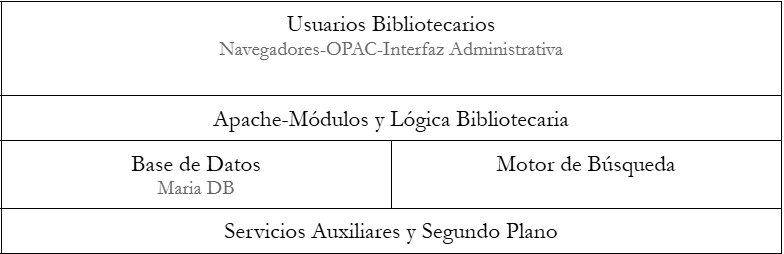

# Diseño de la Infraestructura

El diseño de la infraestructura va tal que así:

Pero es necesario aclarar algunos temas respecto a estas capas de la infraestructuras. En la primera capa, si bien se usa el navegador, el OPAC y la interfaz administrativa son dos conceptos distintos, 
el OPAC es el catálogo público en el cual todos pueden entrar y buscar, mientras que la interfaz administrativa es la herramienta principal para el control de todo el sistema bibliotecario.
Apache es el método principal para que los usuarios y el personal administrativo entre en el OPAC o interfaz, sin este el resto no funciona, es una relación mutua que se necesita para su total funcionamiento.

[Introducción y Objetivos](IntroduccionyObjetivos.md)|[Inicio](README.md)|[Instalación y Configuración del Entorno Virtual](entorno.md)
