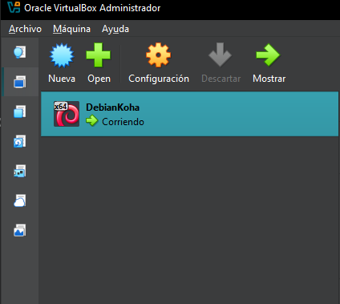
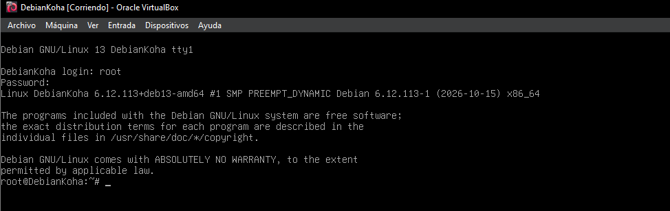

# Instalación y Configuración del Entorno Virtual

Para la instalación necesitaremos Oracle VirtualBox (en nuestro caso la versión 7.2.6) y una ISO de Debian 13. La instalación es sencilla, con un almacenamiento de al menos 10 Gb es más que 
suficiente para empezar y puesto que no vamos a usar entorno gráfico, tampoco necesitaremos mucha memoria.

Para nuestra máquina, estos son los parámetros elegidos:
- Almacenamiento de 10 Gb
- Memoria de 5200 Mb (Unos 5Gb)
- 16 Mb de Memoria de video (Sin entorno gráfico)
- Nombre de la máquina: DebianKoha
- Al terminar de instalarlo, debería tener el siguiente aspecto:

Pero aún no está acabado, aún queda un elemento más a cambiar antes de empezar a trabajar en la instalación del software; dado que Koha trabaja desde una interfaz accesible desde navegador web, 
cambiaremos la configuración de red de la máquina virtual a “Adaptador Puente” de tal forma accederemos 
a la IP o nombre de dominio que hayamos indicado en la configuración (puede ser previa o después de su instalación).

[Diseño de la Infraestructura](diseño.md)|[Inicio](README.md)|[Instalación y Configuración de los Servicios en Red](red.md)
