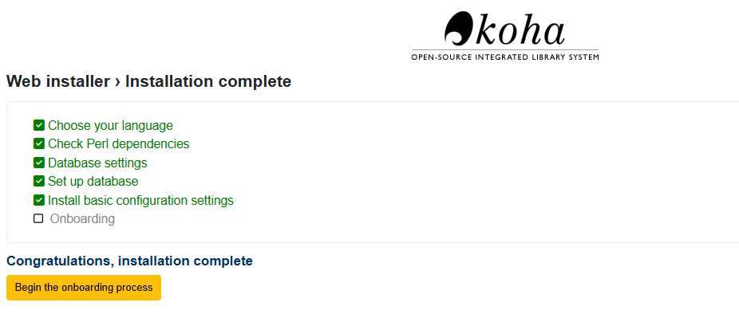
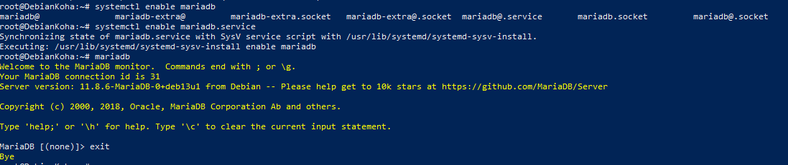
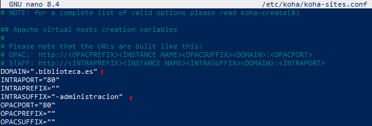
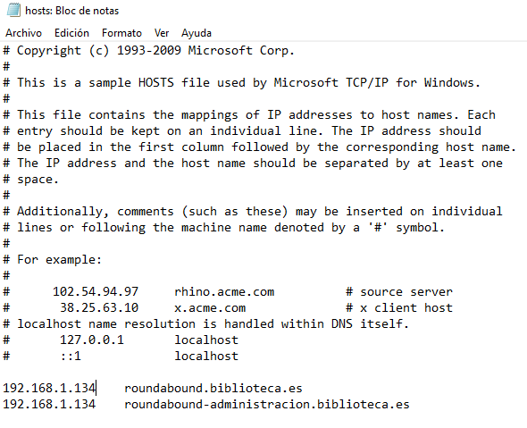
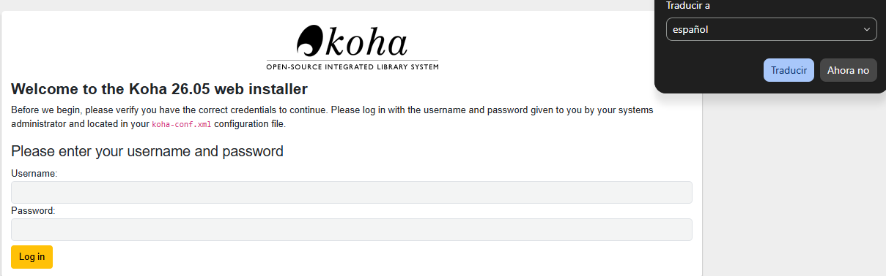
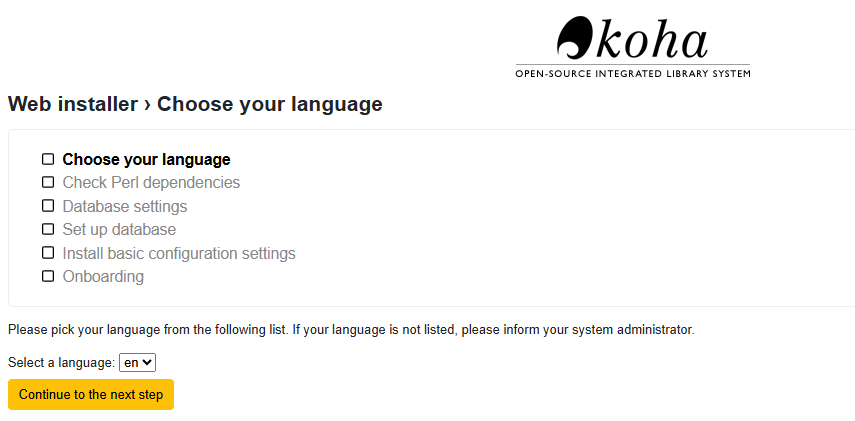

# Koha: Puesta a Punto

### *Para ver la versión anterior de este archivo, que terminó en desastre, haga click [aquí](punto.md)*

Entonces... ¿Koha ha terminado de instalarse? Bien, es un proceso algo lento la verdad; sobre todo porque lanzarlo hace que apache también esté disponible. Ahora empieza el verdadero quebradero
de cabeza, más que nada porque con Koha hay muchísimas migajas, no saber que hacer o cual debería de ser el siguiente paso es la diferencia entre que funcione o todo se vaya al traste. Ahora mismo
tras su finalización de el último paso visto en el anterior punto, podemos poner la IP del servidor en el navegador y veremos el resultado principal, Apache está funcionando en la máquina virtual.



Como es el servicio web más utilizado, Koha lo aprovecha dentro de sus dependencias para instalarlo; si no queremos preocuparnos de tener que encenderlo cada vez que se inicia la máquina
podemos usar "enable" del paquete de "systemctl" que viene de una con debian; aunque es probable que esté en este estado por defecto. También en términos de instalación por defecto,
Koha no tiene una instalación predeterminada para la base de datos, en la documentación recomienda que sea con Mariadb; así que lo vamos a instalar y además en estado "enable" para
evitar tener que encenderlo cada vez que iniciemos la máquina.



Lo recomendado ahora es editar el fichero "**/etc/koha/koha-sites.conf**" y ajustarlo a nuestros requerimientos. ¿Qué vamos a tocar? Pues un total de 2 parámetros en su interior. Primero "**DOMAIN**"
en donde deberá ir la terminación de nuestro dominio, para nosotros es ".biblioteca.es"; luego modificaremos "**ITRASUFFIX**" añadiendo "-administracion" como línea, es el distintivo de que con
este extra, corresponde a la interfaz administrativa. El resto podemos dejarlo tal y como está, para mejor lectura, en la captura siguiente, se puede ver un marcador rojo en 
las líneas que vamos a modificar (localizado al principio del archivo).



Ahora vamos a realizar un par de comandos importantes y además una configuración más que importante para realizar todo esto; primero los dos comandos principales:
```bash
a2enmod rewrite cgi headers proxy_http
systemctl restart apache2
```

Y además:
```bash
koha-create --create-db libraryname
# koha-plack --enable libraryname
# koha-plack --start libraryname
# systemctl restart apache2
```

Esto dejará una respuesta por parte de http para el acceso web, tras hacer el restart de apache, entonces en teoría debería de funcionar, ¿no? Pues permíteme decir que no, no vamos a poder acceder
al instalador web desde fuera por un simple motivo... no conocemos nada de este nombre. En nuestro sistema operativo debemos hacer un pequeño cambio más, en el archivo host correspondiente a nuestra
máquina principal debemos añadir un par de líneas adicionales, las correspondientes a nuestras direcciones OPAC e Interfaz Administrativa, tal que así:



Se puede comprobar que funciona la resolución de nombres haciendo ping a ambas direcciones (Y sí, ha habido un cambio de IPs con respecto a la versión previa). Lo importante corresponde a al instalador web,
al cual podemos acceder introduciendo nuestra dirección de la interfaz administrativa, en nuestro caso se accede por medio de introducir "roundabound-administracion.biblioteca.es/cgi-bin/koha/installer/install.pl"
en la barra superior del navegador (por supuesto, cambia el nombre por el de la tuya propia). El aspecto que tiene es la siguiente:



Este archivo te muestra la versión actual de Koha; podemos acceder con un usuario y contraseña, por defecto, en teoría, deberían ser *koha_kohadev* para el usuario y *password* para la contraseña (Muy seguro, evidentemente). Pero en nuestro caso tiene otro nombre, para nosotros es **koha-roundabound** y la contraseña es un galimatías de texto, que no está encriptado, sólo está elegida de forma completamente aleatoria. Si las credenciales son correctas, y
es muy probable que lo sean (puedes comprobarlo con el comando ***koha-passwd <nombre>***) podremos acceder al instalador web y podremos configurarlo; aunque es muy probable que no tengamos que tocar nada, porque reconocerá lo que tengamos instalado en nuestra máquina virtual.



Y una vez terminemos esta parte, aunque no hayamos terminado la instalación; empezará la configuración de la biblioteca en sí y en parte de los usuarios. Esa es nuestra próxima parada.

[Instalación y Configuración de los Servicios de Red](red.md)|[Inicio](README.md)
