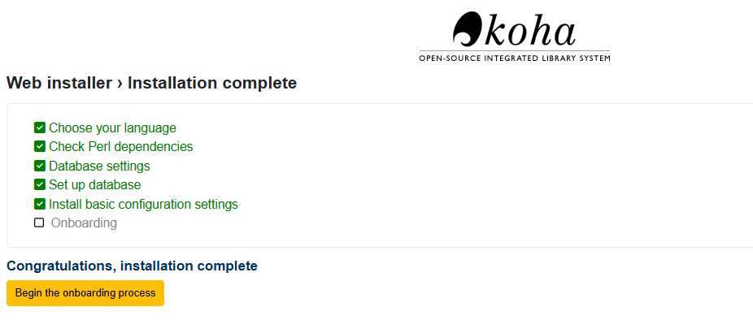
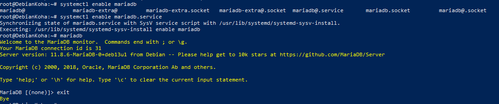
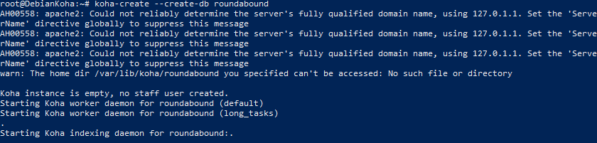
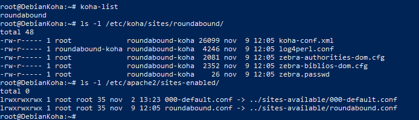
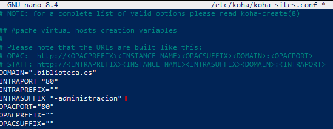
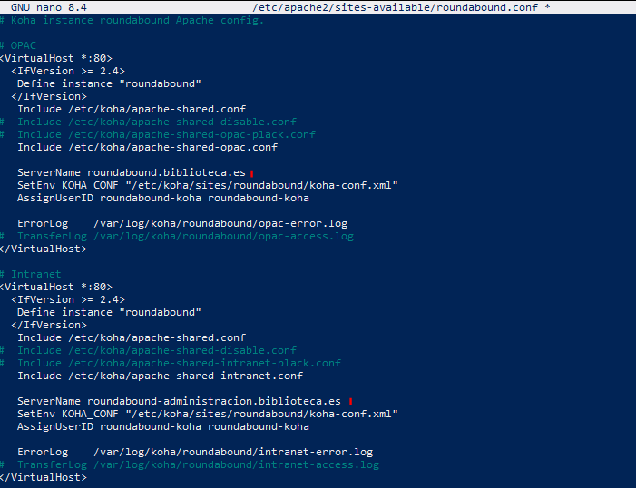
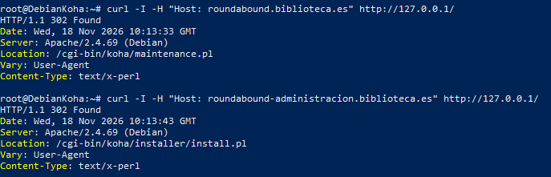

# Koha: Puesta a Punto

## Aviso: Debido a problemas irreversibles de la instalación y problemas constantes, este punto será re-hecho desde cero. Sin embargo se mantendrá activo, pues también dio a relucir algunos problemas de Koha
a la hora de su instalación.

### *Para ver la versión anterior de este archivo, que terminó en desastre, haga click [aquí](puesta.md)*

¿Koha ha terminado de instalarse? ¡Bien! Ahora podemos empezar a configurar poco a poco, hay mucha migaja que escudriñar. 
Empezamos con lo más sencillo, Apache, sencillo de instalar, debería de estar en la versión más reciente cuando hicimos el update previamente. 
¿Por qué? Pues mira, porque al ejecutar la instalación de Koha tras la parafernalia previa de comandos, Apache es un servicio necesario para que funcione, 
por eso si ponemos la IP en el navegador, podemos acceder a este.



Apache es instalado por defecto por ser el servicio web más usado, por ese motivo no instala una dependencia de base de datos de forma automática; debería funcionar con cualquier gestor, en nuestro caso se recomienda que sea MariaDB, por eso realizamos otro update en caso de que haya una actualización de última hora, la instalamos y lo activamos, así no hará falta iniciarlo individualmente cada vez que encendamos.



Ya teniendo esto configurado, lo importante empieza a partir de aquí, ir poco a poco a configurar lo importante en Koha. Para el comienzo, se recomienda crear la instancia de la base de datos con el siguiente comando:

```bash
koha-create  --create-db nombre
```

En este caso lo llamaremos igual al nombre que pusimos en /etc/hosts pero no es necesario que los nombres coincidan en absoluto; uno es el nombre con el cual accedemos, el otro es el nombre interno que se lista
en Koha.



Cuando se lanza el comando, koha se encarga de crear lo necesario, primero crea los sitios en la carpeta “sites” encontrada en “/etc/koha/sites” y aplica el nombre que nosotros le hayamos indicado, también lo muestra en “/etc/apache/sites-enabled” donde además del default, aparece también una nueva instancia con el mismo nombre. Todas las comprobaciones pueden hacerse por medio de los siguientes comandos:
```bash
koha-list
ls -l /etc/koha/sites/nombre
ls -l /etc/apache2/sites-enabled
```


Pero ojo, esto no significa que automáticamente funcionen por arte de magia, hay un archivo que nos concierne configurar primero tras haber hecho la creación; debemos ir a un archivo llamado “koha-sites.conf” ubicado directamente en la carpeta de koha, previo a “sites” o a la correspondiente de nuestro nombre.

En “/etc/koha/koha-sites.conf” se encuentra nuestro siguiente paso, debemos modificar un par de líneas en concreto, la primera bajo la etiqueta domain; la primera sin comentar tras abrir el archivo e INTRASUFFIX (señalada en rojo). Estos campos, que son los únicos a modificar, describen expresamente el dominio que usamos para ambas direcciones, el segundo es referente a la página de la interfaz administrativa; no va con terminación, se da a entender que es la misma que el "Domain"



El trabajo aún está lejos de estar terminado, aún debemos arreglar los enlaces del host para que distinga entre una dirección y la otra a pesar de tener exactamente la misma IP. Por eso vamos a editar otro archivo de
configuración, en el directorio "/etc/apache2/sites-available" encontraremos un archivo de configuración que tiene el nombre que indicamos previamente, en nuestro caso lleva el nombre "roundabound.conf"
```bash
nano /etc/apache2/sites-available/roundabound.conf
```

Al entrar en el archivo nos interesa cambiar el nombre indicado en "SeverName" (indicado en rojo en ambos apartados de VirtualHost), para el primero vamos a indicar el nombre de acceso al OPAC y en el de abajo el
de acceso de la interfaz administrativa. ¿Por qué en ese orden? Pues porque a la hora de su creación, Koha automáticamente creó este archivo, con los dos hosts virtuales preparados, en el primero se puede observar
que en la última línea previo a cerrar el VirtualHost, se puede ver el "ErrorLog" que es la ubicación de a donde se van a enviar los errores, en esa dirección se puede distinguir que pone "opac-error.log" y en el
segundo es "intranet-error.log", aquí es donde indicaremos la otra dirección, la correspondiente a la interfaz administrativa.



Cuando tengamos los hosts preparados, recargamos apache con "systemctl reload apache2.service" y lanzamos los 2 siguientes comandos:

```bash
curl -I -H "Host: roundabound.biblioteca.es" http://127.0.0.1/
curl -I -H "Host: roundabound-administracion.biblioteca.es" http://127.0.0.1/
```

Nos debería resolver los siguientes resultados:



Sin embargo, que esto responda no significa que podamos acceder ya a las versiones web; puede darse un caso en el cual Koha reconozca que las páginas están en un estado de mantenimiento, si lanzamos el comando ' curl -v http://localhost -H "Host: roundabound.biblioteca.es" ' (y el mismo comando, pero la interfaz administrativa) encontraremos un desglose del host, una de las líneas dice **location** y puede indicar **/cgi/koha/maintenance.pl** y es posible que se haya considerado que estén ambas aquí. Adicionalmente puede haber otro problema, la base de datos puede no existir. Muchas migajas a tocar... lo sé, pero es lo que hay. Vamos a ir poco a poco.


[Inicio](README.md)
