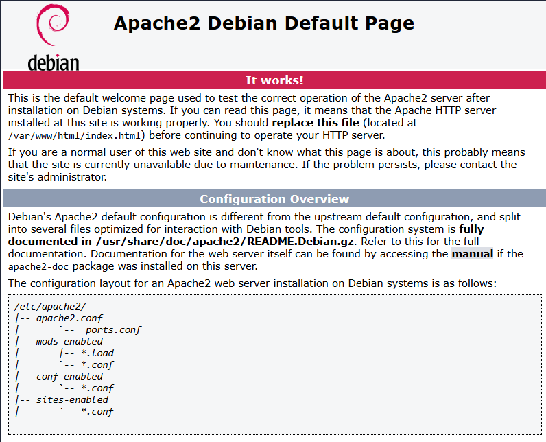
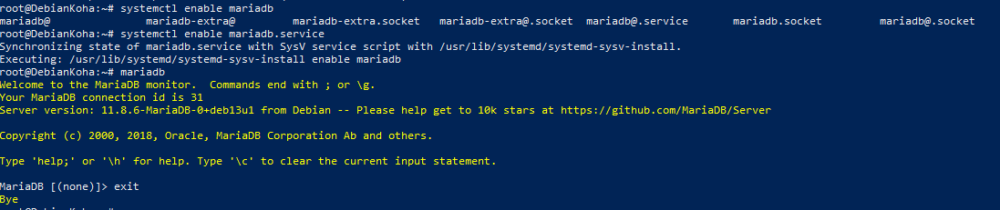
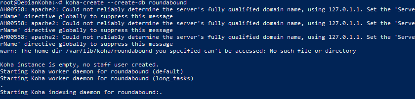
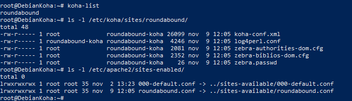

# Koha: Puesta a Punto

¿Koha ha terminado de instalarse? ¡Bien! Ahora podemos empezar a configurar poco a poco, hay mucha migaja que escudriñar. 
Empezamos con lo más sencillo, Apache, sencillo de instalar, debería de estar en la versión más reciente cuando hicimos el update previamente. 
¿Por qué? Pues mira, porque al ejecutar la instalación de Koha tras la parafernalia previa de comandos, Apache es un servicio necesario para que funcione, 
por eso si ponemos la IP en el navegador, podemos acceder a este.



Apache es instalado por defecto por ser el servicio web más usado, por ese motivo no instala una dependencia de base de datos de forma automática; debería funcionar con cualquier gestor, en nuestro caso se recomienda que sea MariaDB, por eso realizamos otro update en caso de que haya una actualización de última hora, la instalamos y lo activamos, así no hará falta iniciarlo individualmente cada vez que encendamos.



Ya teniendo esto configurado, lo importante empieza a partir de aquí, ir poco a poco a configurar lo importante en Koha. Para el comienzo, se recomienda crear la instancia de la base de datos con el siguiente comando:

```bash
koha-create  - -create-db nombre
```

En este caso lo llamaremos igual al nombre que pusimos en /etc/hosts pero no es necesario que los nombres coincidan en absoluto; uno es el nombre con el cual accedemos, el otro es el nombre interno que se lista
en Koha.



Cuando se lanza el comando, koha se encarga de crear lo necesario, primero crea los sitios en la carpeta “sites” encontrada en “/etc/koha/sites” y aplica el nombre que nosotros le hayamos indicado, también lo muestra en “/etc/apache/sites-enabled” donde además del default, aparece también una nueva instancia con el mismo nombre. Todas las comprobaciones pueden hacerse por medio de los siguientes comandos:
```bash
koha-list
ls -l /etc/koha/sites/nombre
ls -l /etc/apache2/sites-enabled
```


Pero ojo, esto no significa que automáticamente funcionen por arte de magia, hay un archivo que nos concierne configurar primero tras haber hecho la creación; debemos ir a un archivo llamado “koha-sites.conf” ubicado directamente en la carpeta de koha, previo a “sites” o a la correspondiente de nuestro nombre.
