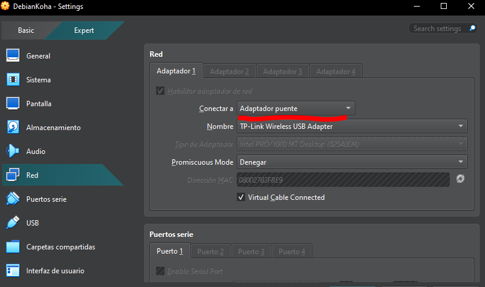
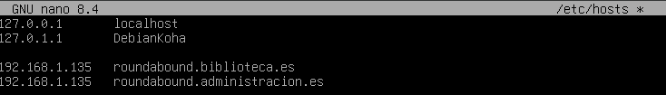
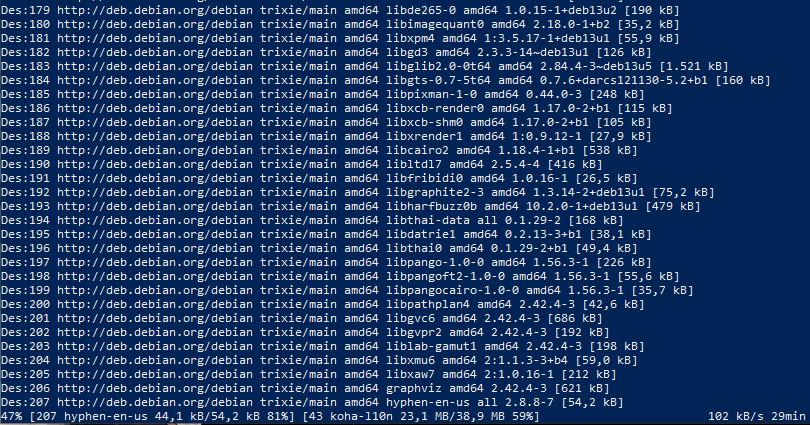

# Instalación y Configuración de los Servicios de Red

Como ya dijimos, lo primero es seleccionar el adaptador de red a modo puente, a parte de servirnos para acceder a las direcciones IP de la máquina virtual, 
esto también nos permite obtener internet dentro de Debian 13, necesario para actualizar las dependencias de la máquina.


Para esto no hace falta entrar en mucho detalle, primero es recomendable actualizar, porque lo nuestro es una máquina instalada de cero, muchos paquetes estarán en su versión base,
realizar una actualización rápida no tomará más de unos cinco minutos, en los comandos siguientes, el primero actualiza las dependencias, el segundo aplica los cambios:
```bash
apt update
apt upgrade
```
Ahora vendría un dilema: ¿Primero instalamos Koha o se configura algo más? En realidad, el orden no importa mucho, por lo cual vamos a preparar primero los nombres del dominio, 
necesitamos dos nombres, uno para la interfaz administrativa y otra para la OPAC.
Este paso es sencillo, introducimos el siguiente comando:

```bash
nano /etc/hosts
```
Y añadimos las siguientes líneas just debajo de nuestra dirección de localhost (la numerada como 127.0.0.1):


Guardamos y salimos del archivo.

Hay un detalle que hay que vigilar, Koha no viene por defecto en los repositorios de Debian; hay que añadirlo para poder instalarlo. Para ello hay que hacer una lista de comandos en orden
antes de poder hacer el tan famoso "apt install" con Koha. La lista de comandos es la siguiente:

```bash
sudo apt install curl ca-certificates
sudo install -d -m 0755 /etc/apt/keyrings
curl -fsSL https://debian.koha-community.org/koha/gpg.asc | sudo gpg --dearmor --yes -o /etc/apt/keyrings/koha.gpg
sudo chmod 644 /etc/apt/keyrings/koha.gpg
echo "deb [signed-by=/etc/apt/keyrings/koha.gpg] https://debian.koha-community.org/koha stable main" | sudo tee /etc/apt/sources.list.d/koha.list
# Y a partir de aquí podemos realizar los siguientes tres comandos
sudo apt update
apt-cache policy koha-common
sudo apt install koha-common
```


¿Por qué hacerlo ahora? Pues porque aún no estamos directamente trabajando con Koha, estamos instalándolo; en el siguiente punto veremos que archivos tocar, que otras comprobaciones necesitamos para que funcione, es decir
vamos a trabajar en su **puesta a punto**.

[Instalación y Preparación del Entorno Virtual](entorno.md)|[Inicio](README.md)|[Koha: Puesta a punto](punto.md)
