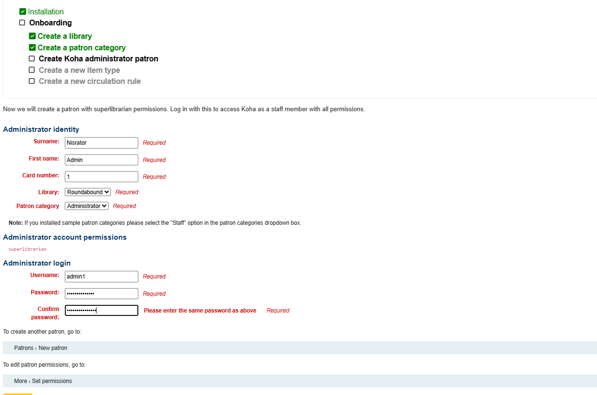
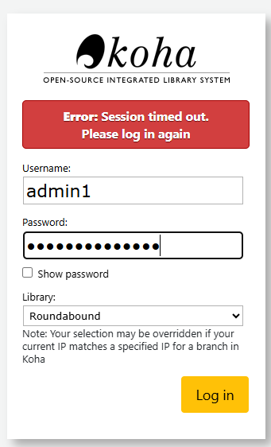
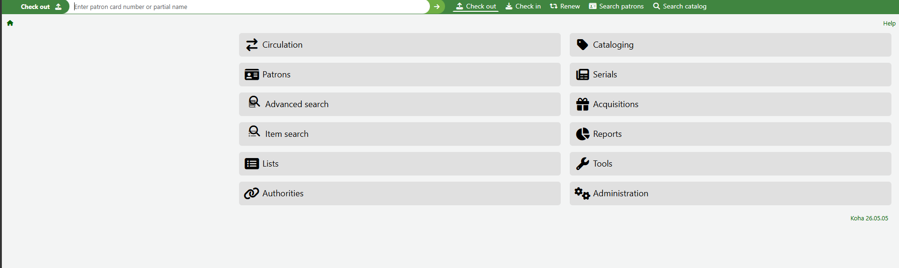

# Administración y Gestión de Usuarios

Bien, vamos por partes; durante la instalación ya hemos creado un usuario esencial para el funcionamiento de Koha, el administrador. Este usuario será el principal encargado de realizar las 
tareas administrativas de nuestra biblioteca; la interfaz de creación es sencilla, debemos añadir personalmente sus datos, a que biblioteca pertenece y además una contraseña que debe cumplir
con los requisitos (al menos 1 mayúscula, un número y longitud de al menos 8 caracteres). 

Para continuar, deberemos terminar de realizar la instalación de Koha, este paso se realiza en medio de la instalación, cuando termina todo el proceso, el programa te redirecciona automáticamente
a la interfaz administrativa con una ventana de Login. En este cuadro es donde introducimos las credenciales de nuestro usuario administrador, recuerda que la contraseña debía tener
ciertos parámetros a la hora de adjudicarla; al introducirla correctamente al fin tendremos acceso a la interfaz administrativa (y al OPAC).

